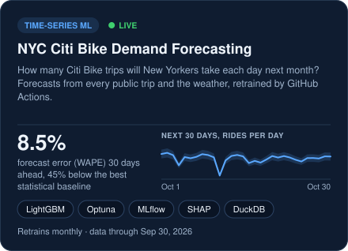
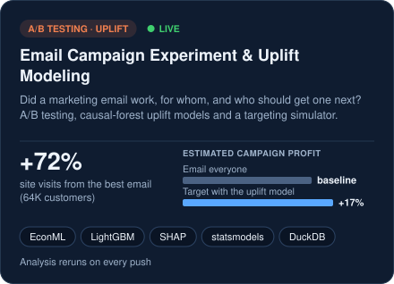
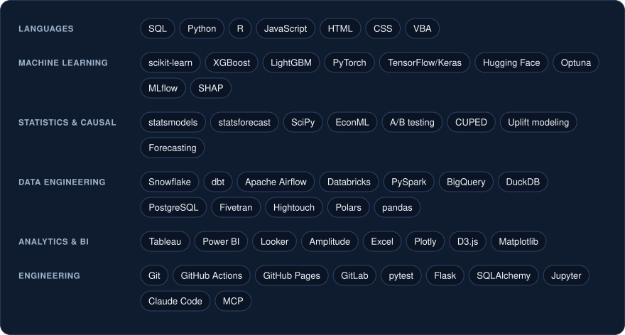

  &nbsp;
  &nbsp;
  

### About me

I'm finishing an **MSc in Business Analytics at Ivey Business School** (December 2026). This summer I was a
**Data Analyst Intern at Super.com**, where I shipped production dbt models, built an Airflow → Snowflake
pipeline, and traced conversion drops through funnel and cohort analysis.

I like problems where the answer changes a decision: how much demand to plan for, who to target, and whether an
experiment really worked. I'm looking for **data science, analytics engineering and data analyst roles starting
December 2026**, in Canada or the U.S. (Canadian citizen, TN-eligible).

### Featured projects

Both projects run end to end on GitHub: tests on every push, scheduled retraining with GitHub Actions, and live
reports on GitHub Pages. Click a card to open its live report.

<a href="https://dvskaff.github.io/citibike-demand-forecasting/"><b>Live dashboard</b></a> · <a href="https://github.com/dvskaff/citibike-demand-forecasting">Code</a>

<a href="https://dvskaff.github.io/email-campaign-uplift/"><b>Live report & simulator</b></a> · <a href="https://github.com/dvskaff/email-campaign-uplift">Code</a>

### Toolkit

<b>How this profile updates itself</b>

 

The project cards above are not screenshots. Every Monday a GitHub Action
([`refresh.yml`](.github/workflows/refresh.yml)) runs [`scripts/build_profile.py`](scripts/build_profile.py),
which downloads the latest results each project publishes to GitHub Pages, redraws the cards as SVGs, and commits
them. When the Citi Bike model retrains each month, its card updates on its own.

Cards last refreshed: <!-- REFRESHED -->Nov 1, 2026<!-- /REFRESHED -->
