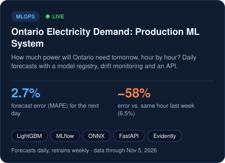
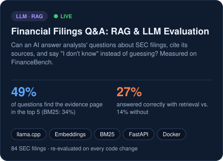
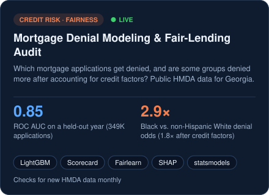
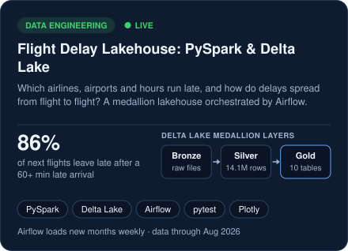
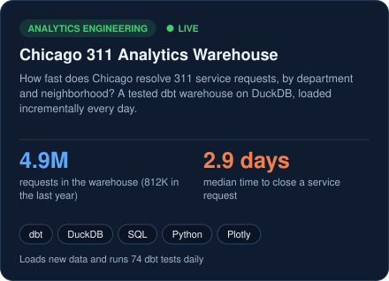
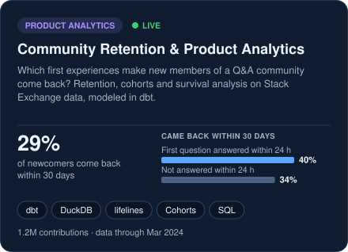

  &nbsp;
  &nbsp;
  

### About me

I'm finishing an **MSc in Business Analytics at Ivey Business School** (December 2026). This summer I was a
**Data Analyst Intern at Super.com**, where I shipped production dbt models, built an Airflow → Snowflake
pipeline, and traced conversion drops through funnel and cohort analysis.

I enjoy working across the whole data lifecycle: building reliable pipelines and warehouse models, turning data
into metrics and analysis people can trust, and training and shipping machine learning models that improve real
decisions. I'm looking for **data analyst, data engineer, data scientist, machine learning engineer and analytics
engineer roles in the U.S., starting January 2027**. As a Canadian citizen, I'm eligible for a TN visa, so U.S.
employers can hire me without H-1B sponsorship.

### Featured projects

Eight end-to-end projects on real public data. Each one runs entirely on GitHub: tests on every push, scheduled
data loads and retraining with GitHub Actions, and a live dashboard on GitHub Pages. Click a card to open it.

<!-- PROJECTS:START -->

<!-- PROJECTS:END -->

#### Projects by role

<!-- ROLES:START -->
| Project | Best fit for | Links |
|---|---|---|
| **Ontario Electricity Demand: Production ML** | ML Engineer | [Live forecast](https://dvskaff.github.io/ontario-demand-forecasting/) · [Code](https://github.com/dvskaff/ontario-demand-forecasting) |
| **Financial Filings Q&A: RAG & LLM Evaluation** | ML Engineer | [Live evaluation](https://dvskaff.github.io/filings-rag-eval/) · [Code](https://github.com/dvskaff/filings-rag-eval) |
| **Mortgage Denial Model & Fair-Lending Audit** | Data Scientist | [Live dashboard](https://dvskaff.github.io/mortgage-fair-lending-model/) · [Code](https://github.com/dvskaff/mortgage-fair-lending-model) |
| **Email Experiment & Uplift Modeling** | Data Analyst, Data Scientist | [Live report & simulator](https://dvskaff.github.io/email-campaign-uplift/) · [Code](https://github.com/dvskaff/email-campaign-uplift) |
| **Flight Delay Lakehouse: PySpark & Delta Lake** | Data Engineer | [Live dashboard](https://dvskaff.github.io/flight-delay-lakehouse/) · [Code](https://github.com/dvskaff/flight-delay-lakehouse) |
| **Chicago 311 Analytics Warehouse** | Analytics Engineer, Data Engineer | [Live dashboard](https://dvskaff.github.io/chicago-311-warehouse/) · [Code](https://github.com/dvskaff/chicago-311-warehouse) |
| **What Makes Newcomers Stick?** | Data Analyst, Analytics Engineer | [Live dashboard](https://dvskaff.github.io/community-retention-analytics/) · [Code](https://github.com/dvskaff/community-retention-analytics) |
| **NYC Citi Bike Demand Forecasting** | Data Scientist | [Live dashboard](https://dvskaff.github.io/citibike-demand-forecasting/) · [Code](https://github.com/dvskaff/citibike-demand-forecasting) |
<!-- ROLES:END -->

### Toolkit

<b>How this profile updates itself</b>

 

The project cards above are not screenshots. Every Monday a GitHub Action
([`refresh.yml`](.github/workflows/refresh.yml)) runs [`scripts/build_profile.py`](scripts/build_profile.py),
which downloads the latest results each project publishes to GitHub Pages, redraws the eight cards as SVGs,
rewrites the project grid and table, and commits them. When a project loads new data or retrains, its card
updates on its own; if a site is briefly unavailable, its card keeps the last good numbers.

Cards last refreshed: <!-- REFRESHED -->Nov 7, 2026<!-- /REFRESHED -->
